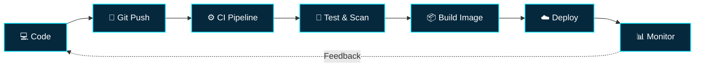

<div align="center">


<a href="https://github.com/shivamrajsr07"></a>
<a href="https://www.linkedin.com/in/impressiveboy"></a>
<a href="mailto:shra23cs@cmrit.ac.in"></a>


</div>

---

## `$ whoami`

```yaml
name: Shivam Raj
role: DevOps Engineering Intern
company: Tiket International Network Pvt. Ltd.
education: Computer Science Engineering
institute: CMR Institute of Technology, Bengaluru
interests:
  - DevOps and Cloud Engineering
  - Infrastructure Automation
  - CI/CD and Containerization
  - Reliability and Observability
  - AI and Backend Development
mindset: Learn | Automate | Deploy | Improve
```

I'm a Computer Science Engineering student and **DevOps Engineering Intern** interested in building reliable systems and improving the way software is delivered. I enjoy exploring the connection between software development, cloud infrastructure, automation, monitoring, and security.

- ☁️ Learning cloud infrastructure and deployment workflows.
- 🐧 Strengthening Linux, networking, and shell scripting fundamentals.
- 🔄 Exploring CI/CD pipelines and Infrastructure as Code.
- 🐳 Building practical knowledge of Docker and Kubernetes.
- 📈 Learning observability, reliability, security, and cloud cost awareness.
- 🤖 Applying my software development and AI/ML background to practical projects.

> **My engineering loop:** Understand → Automate → Deploy → Observe → Improve

---

## 💼 Professional Experience

### ☁️ DevOps Engineering Intern
**Tiket International Network Pvt. Ltd.**

- Developing practical knowledge of DevOps workflows and infrastructure operations.
- Exploring cloud environments, Linux administration, networking, and automation.
- Learning containerization, CI/CD, deployment, and monitoring practices.
- Building an understanding of reliability, security, and cost-aware infrastructure.

*This profile showcases personal projects and public learning, not confidential company infrastructure.*

---

## ⚙️ DevOps Workflow



*Conceptual workflow, not a claim that this complete pipeline is deployed in production.*

---

## 🧰 Technology Stack

### Cloud, DevOps & Infrastructure

<p>
  
</p>

### CI/CD & Observability

<p>
  
</p>

### Programming & Backend

<p>
  
</p>

### Frontend & AI/ML

<p>
  
</p>

*These icons represent my toolkit and learning areas, not equal proficiency in every technology.*

---

## 🚀 Featured Projects

### ☁️ DevOps & Cloud Engineering Lab

A hands-on portfolio for documenting infrastructure and automation experiments.

**Focus:** Linux administration, Bash, CI/CD, Docker, AWS, Terraform, Kubernetes, monitoring, and cloud cost optimization.

### 🤖 AI Interview Analyzer

An AI-powered application for interview analysis and resume insights.

**Stack:** Python · Streamlit · OpenCV · NLP

### 🌾 AgriPulse AI

An AI-driven agricultural platform exploring crop disease detection and recommendations.

**Stack:** Python · Machine Learning

### 🚦 Traffic Demand Forecasting

A machine learning project exploring traffic-demand prediction with gradient-boosting models.

**Stack:** Python · LightGBM · CatBoost · XGBoost

### 📅 Deadline Guardian AI

An AI productivity assistant for managing student tasks and deadlines.

**Stack:** React · Node.js · Firebase · Google Gemini

> Add direct repository links to these project headings when the corresponding repositories are public. Prioritize working demos, architecture diagrams, setup instructions, and lessons learned.

---

## 🗺️ Current Learning Roadmap

| Area | Current focus |
|---|---|
| Linux & networking | Commands, permissions, processes, SSH, DNS, and ports |
| Shell scripting | Bash fundamentals and task automation |
| AWS & cloud | Core services, IAM, networking, compute, and storage |
| CI/CD | Pipeline stages, tests, artifacts, and deployment workflows |
| Containers | Docker images, containers, volumes, and networks |
| Orchestration | Kubernetes workloads, services, and configuration |
| Infrastructure as Code | Terraform fundamentals and repeatable provisioning |
| Observability | Metrics, logs, dashboards, and alerting |
| DevSecOps & FinOps | Least privilege, secrets, resource efficiency, and cost awareness |

---

## 📊 GitHub Control Room

<div align="center">
  
  
</div>

<div align="center">
  
</div>

<div align="center">
  
</div>

---

## 🐍 Contribution Snake

<div align="center">
  <picture>
    <source media="(prefers-color-scheme: dark)" srcset="https://raw.githubusercontent.com/shivamrajsr07/shivamrajsr07/output/github-contribution-grid-snake-dark.svg"/>
    <source media="(prefers-color-scheme: light)" srcset="https://raw.githubusercontent.com/shivamrajsr07/shivamrajsr07/output/github-contribution-grid-snake.svg"/>
    
  </picture>
</div>

---

## 🏆 Highlights

- 🏅 Smart India Hackathon Finalist
- 🚀 Hackathon participant and project builder
- 🤖 AI/ML and backend application prototyping
- ☁️ DevOps and cloud engineering career development

---

## 🖥️ Terminal Session

```bash
shivam@cloud-lab:~$ whoami
Shivam Raj

shivam@cloud-lab:~$ cat current_role.txt
DevOps Engineering Intern

shivam@cloud-lab:~$ echo $FOCUS
Cloud | Linux | CI/CD | Automation

shivam@cloud-lab:~$ git status
Learning new skills...
Building practical projects...
Improving every day...

shivam@cloud-lab:~$ deploy --future
Reliable. Secure. Scalable.

shivam@cloud-lab:~$ _
```

---

## 🤝 Let's Connect

<div align="center">

<a href="https://github.com/shivamrajsr07"></a>
<a href="https://www.linkedin.com/in/impressiveboy"></a>
<a href="https://leetcode.com/u/shra23cs/"></a>
<a href="mailto:shra23cs@cmrit.ac.in"></a>

<br/><br/>


**Thanks for stopping by.**

*Learn continuously. Automate thoughtfully. Ship reliably.* ☁️

</div>
